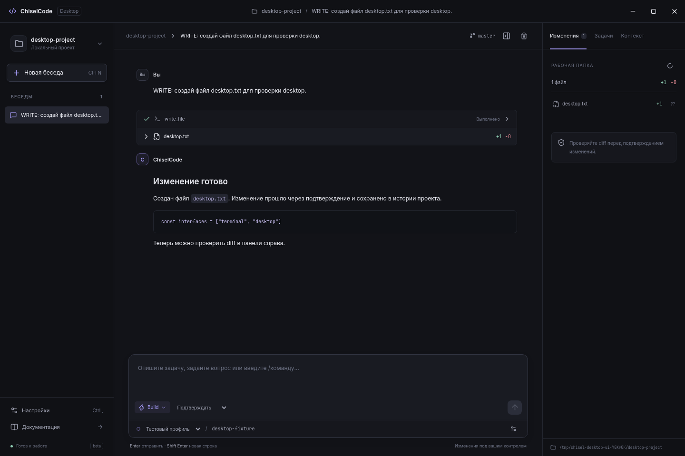

# ChiselCode Desktop

**От задачи до проверяемого изменения — в отдельном приложении.**

Графический клиент [ChiselCode](https://github.com/TheAsrada/ChiselCode): проекты, история бесед, потоковый ответ, модели разных провайдеров и просмотр изменений перед подтверждением. Терминальная версия продолжает развиваться; оба интерфейса используют общее ядро.

[Скачать beta](https://github.com/TheAsrada/ChiselCodeDesktop/releases/tag/v0.1.0-beta.1) · [Документация](docs/README.md) · [Архитектура](docs/architecture.md) · [CHANGELOG](CHANGELOG.md)



## Первый запуск

1. Установите приложение из GitHub Releases и откройте папку проекта.
2. В **Настройки → Модели и подключение** выберите провайдера, укажите модель и свой API-ключ. Готовые профили CLI появятся автоматически.
3. Напишите задачу. **Plan** изучает проект; **Build** выполняет изменения с выбранным режимом разрешений.
4. Изучите запрос подтверждения и diff. Разрешите действие или отклоните его.

Ядро и Bun включены в установщик. Для Git-функций нужен Git. ChiselCode не предоставляет модель и API-кредиты.

## Возможности первой beta

- Проекты и общая с CLI история; отдельные беседы и параллельные задачи.
- Markdown, код, потоковый ответ, карточки инструментов и сохранённые diff.
- Plan/Build, подтверждения, отказ, остановка и очередь следующего сообщения.
- Общие профили провайдеров, проверка подключения и выбор модели.
- Просмотр Git, навыки, команды расширений и MCP HTTP/stdio.
- Состояния помощников и фоновых задач, запуск worktree-команд через общее ядро.
- Тёмная, светлая и системная темы; горячие клавиши и уведомления.
- Проверка обновлений; UI и встроенное ядро обновляются одним выпуском.

Это первый beta-выпуск. Отдельные графические сценарии `/btw`, сложных extension UI contributions, расширенных LSP-форм и истории фоновых процессов продолжают развиваться. Текущая доступность описана в [таблице возможностей](docs/features.md).

При одновременной работе CLI и desktop с одной папкой используйте CLI **0.6.28 или новее** с execution lease. Старые версии не соблюдают новый допуск. Два процесса согласуют выполнение консервативно; для независимой работы подходят отдельные клоны.

## Почему ядро легко обновлять

В этом репозитории находятся Electron, preload и React-интерфейс. AgentRuntime, инструменты, провайдеры, разрешения, миграции и публичный desktop SDK принадлежат ChiselCode. `engine.lock.json` закрепляет точный выпуск, исходный commit, версию протокола и SHA-256 каждого артефакта. Новые инструменты и провайдеры движка отображаются через общий контракт; их реализация сюда не копируется.

```sh
npm run update:engine -- v0.6.30
npm run sync:engine
npm ci
npm run verify
npm run test:e2e
```

`v0.6.30` здесь — пример следующего выпущенного ядра. Подробности и условия совместимости: [обновление ядра](docs/engine-updates.md).

## Для разработки

```sh
npm run sync:engine
npm ci
npm run icon
npm run dev
```

Нужен Node.js 24.19+ и системные зависимости Electron. Сборка: `npm run package`. [Руководство разработчика](docs/development.md) · [Выпуск установщиков](docs/releases.md) · [Исследование референсов](docs/references.md).

Скриншоты получены из настоящего Electron-приложения с автономным ядром и локальным тестовым провайдером. MIT.
