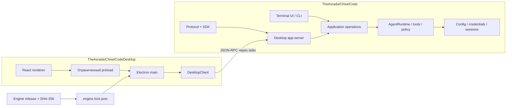

# Архитектура

## Решение

ChiselCode — источник общего ядра и wire contract. ChiselCodeDesktop — источник графического клиента. Реализация runtime сюда не копируется и не форкается.

## Владение

| Область | Репозиторий и слой |
|---|---|
| LLM drivers, каталог моделей/провайдеров, prompt/context | ChiselCode |
| File editing, Git mutations, permissions, approvals, worktrees | ChiselCode |
| MCP, LSP, skills, extensions, helpers, background processes | ChiselCode |
| Сессии, миграции, credentials, project registry | ChiselCode |
| Desktop DTO, validation, SDK, application adapter | ChiselCode `src/desktop` |
| Окно, диалоги ОС, уведомления, updater | Desktop Electron main |
| Страницы, композиция, темы, клавиатура, клиентская очередь | Desktop React |

CLI пока использует существующий application path в процессе; app-server вызывает те же операции. Это общий движок с двумя адаптерами. Перенос всего TUI в server-client модель остаётся отдельной миграцией: первая beta не требует её для запуска или обновления desktop.

## Процессы

Одно окно desktop владеет одним встроенным `chisel-engine`. В ядре один extension host приложения и MCP manager по canonical project root. Conversation owner переживает смену выбранной беседы; foreground turn имеет отдельный AbortController. Один turn на беседу, несколько бесед допускают параллельную работу в одном процессе. Очередь следующих сообщений принадлежит клиенту и фиксирует профиль, модель, Plan/Build и permission mode при отправке.

При закрытии приложения main посылает shutdown, ядро отменяет разрешения и задачи, закрывает managers/host и процессы. Принудительное завершение не повторяет инструменты при следующем запуске. Очередь первого beta хранится в памяти; после аварии пользователь повторно решает, какую задачу отправить.

## Состояние

Durable Session и конфигурация принадлежат core. Renderer хранит выбранный экран, черновики, live stream и скролл. Последний проект и оформление сохраняются в desktop user data; API-ключи туда не записываются. Смена вкладки сохраняет live state; после terminal event клиент читает durable snapshot и заменяет временный вывод. Последовательность событий используется для диагностики; replay событий через перезапуск процесса не обещается.

Имена и идентификаторы tools являются данными. Desktop рисует общие карточки и diff, поэтому новый core tool обычно работает без нового React-компонента. Новое специально оформленное действие требует добавления DTO/capability и клиентской поддержки.

## Согласование CLI и desktop

В core 0.6.28 введён process execution lease по canonical Git common directory или корню обычного проекта. Он предотвращает два независимых процесса, одновременно выполняющих задачу в одной области. Внутри процесса сохраняется WorkspaceCoordinator с более узкими read/write ресурсами. Активные фоновые работы удерживают допуск.

Старый CLI до введения lease не знает этого контракта. Его нельзя считать безопасным concurrent writer общей папки. Структура Session остаётся прежней schemaVersion=3; чтение и перенос истории не требуют отдельного desktop migration engine.

## Граница renderer

Node integration выключена, contextIsolation и renderer sandbox включены. Preload публикует только фиксированные методы. Main проверяет sender и allowlist; shutdown/initialize не доступны renderer. Markdown не исполняет HTML, удалённые изображения не загружаются; внешние ссылки открываются через проверенный HTTP/HTTPS URL. CSP не допускает удалённые scripts или подключение renderer к LLM напрямую.

Инструменты выполняются с прежними правами ChiselCode. UI sandbox не изолирует shell или доверенное JS-расширение внутри ядра; эта граница описана пользователю без обещаний новой системной sandbox.

## Обновление

Каждый desktop installer включает точный binary ядра, SDK и bundled skills. `engine.lock.json` хранит source commit, tag, protocol и hashes. Системный chisel из PATH не используется. Updater заменяет весь выпуск приложения; отдельная неподтверждённая замена engine во время задачи не выполняется. [Процедура обновления](engine-updates.md) обязательна и для изменений, которые выглядят как простая замена binary.
