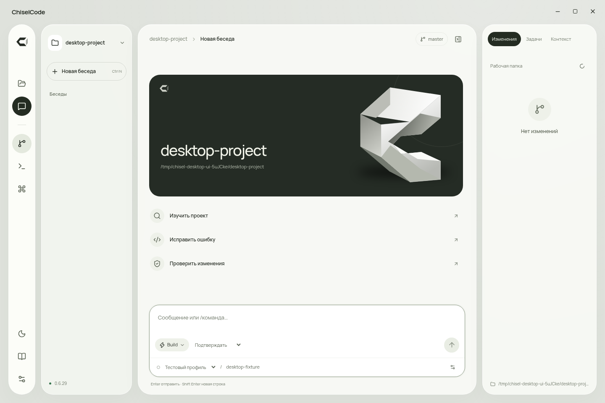
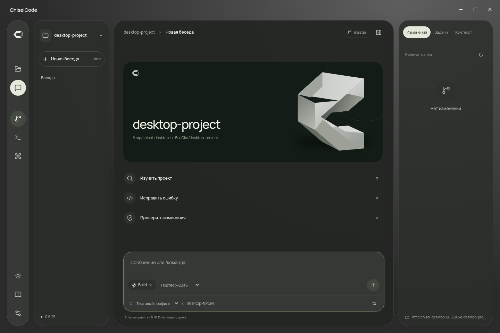
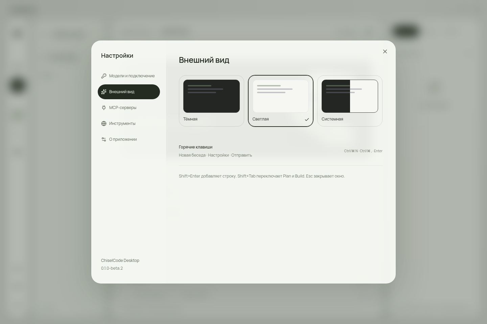

# Оформление Desktop

Новое оформление находится в `main` после 0.1.0-beta.2 и готовится к следующему выпуску. Кадры получены из настоящего Electron с закреплённым ChiselCode 0.6.29. Установщики beta.2 содержат предыдущий интерфейс.

## Референсы владельца

14 октября 2026 года изучены три присланных изображения: монохромная панель управления Coders, полупрозрачный киноинтерфейс и Orizon Design с органичной рамкой и плавающей навигацией.

| Референс | Что определяет оформление ChiselCode |
| --- | --- |
| Coders | Дымчатая основа, отдельные светлые поверхности, чёрные круглые действия, контрастная центральная плоскость |
| Киноинтерфейс | Глубина полупрозрачных слоёв, компактная навигация, мягкое отделение главного содержания от окружения |
| Orizon Design | Крупные радиусы оболочки, самостоятельная навигационная капсула, выразительная форма фирменного знака |

Главное содержание приложения — проект, беседа и изменения кода. Крупная типографика показывает настоящее имя проекта; фон и знак относятся к ChiselCode. Показатели, аватары команд, рекламные заголовки и иллюстрации из референсов в интерфейс не перенесены.

Использован [frontend-design](https://github.com/anthropics/skills/tree/main/skills/frontend-design), установленный командой `npx skills add https://github.com/anthropics/skills --skill frontend-design --agent codex --yes`. Skill установлен в рабочие инструменты разработчика, не в пользовательские навыки ChiselCode и не в установщик.

## Композиция

Навигация, история, рабочая область и inspector имеют разную форму и плотность. Навигационная капсула содержит действия с понятными tooltip/accessible labels. История остаётся отдельной поверхностью. Поле ввода закреплено внизу рабочей области; длинная беседа прокручивается внутри неё.

На начальном экране одна контрастная плоскость показывает название и путь проекта. Собственный SVG-знак Chisel составлен из гранёных поверхностей и используется также в навигации и сообщениях агента. Быстрые действия располагаются строками: «Изучить проект», «Исправить ошибку», «Проверить изменения». Нажатие заполняет черновик и выбирает соответствующий Plan/Build; выполнение начинается только после отправки.

При узком окне inspector становится закрываемой панелью поверх рабочей области. Закрытие возвращает доступ к полю ввода и сохраняет проект, беседу и черновик. Минимальное окно приложения — 900 × 640; отдельные проверки выполняются для content size 1080 × 760 и 920 × 700.

## Цвет и типографика

| Роль | Светлая тема | Тёмная тема |
| --- | --- | --- |
| Окружение | `#dfe2dc` | `#2b2c2b` |
| Рабочая поверхность | `#f9faf5` с прозрачностью | `#242624` с прозрачностью |
| Основной текст | `#252b23` | `#eceee8` |
| Главное действие | `#242c22` | `#e4e9dc` |
| Плоскость проекта | `#252c25` | `#131c16` |

Интерфейс использует локально поставляемый variable Manrope с кириллицей. Код и строки diff используют JetBrains Mono. Цветные акценты обозначают изменения, ошибки, разрешения и состояния операций. Заметная графика сосредоточена на начальном экране; беседа, код и формы сохраняют спокойную иерархию.

Светлая тема используется при первом запуске. Сохранённый выбор пользователя имеет приоритет; системная тема продолжает следовать настройке ОС. В навигации есть переключение светлой/тёмной темы, в настройках — все три варианта.

## Тексты и доступность

В интерфейсе остаются названия действий, фактические данные и состояния. Нет приветственных обещаний, слоганов и пояснений вроде «готов к работе» или «изменения под вашим контролем». Подсказки о разрешениях, последствиях удаления, ошибках подключения и сочетаниях клавиш помогают выполнить конкретное действие.

Кнопки с иконками имеют accessible labels и tooltips; выбранные элементы навигации сообщают `aria-pressed`. Клавиатурный фокус видим. `prefers-reduced-motion` отключает декоративные переходы; индикаторы выполняющихся операций сохраняют смысл при уменьшенной анимации.

## Реализация и проверки

- `tokens.css` — семантические цвета и глубина обеих тем.
- `layout.css` — композиция окна, навигация, главный экран, поле ввода и адаптация размеров.
- `content.css` — беседа, инструменты, diff, настройки и диалоги.
- `components/Brand.tsx` — собственный знак и гранёная форма главного экрана.
- `assets/icon.svg` и получаемый через `npm run icon` PNG — тот же знак для окна и установщиков.

Дизайн меняет графический клиент и цвет фона native window. Общие runtime, storage, protocol, SDK и CLI не меняются; `engine.lock.json` остаётся закреплённым на 0.6.29. Их перенос или новый core release для этой задачи не требуется.

GUI acceptance выполняет настоящий model/tool loop с записью после разрешения, отказом, отменой и восстановлением истории. Дополнительно проверяются быстрые действия Plan/Build, сохранение черновика при навигации, тема после перезапуска и доступность поля ввода при уменьшении окна. Тот же сценарий используется для установленных payload.

Локально 14.10.2026 прошли `npm run verify` (TypeScript, три архитектурные/release проверки и сборка), исходный Electron GUI и полный GUI-сценарий из заново собранных Linux `.deb` и AppImage. SHA-256 встроенного engine совпадает с `engine.lock.json`. Проверка установщиков выбирает точную текущую версию, даже если рядом сохранены старые файлы.

