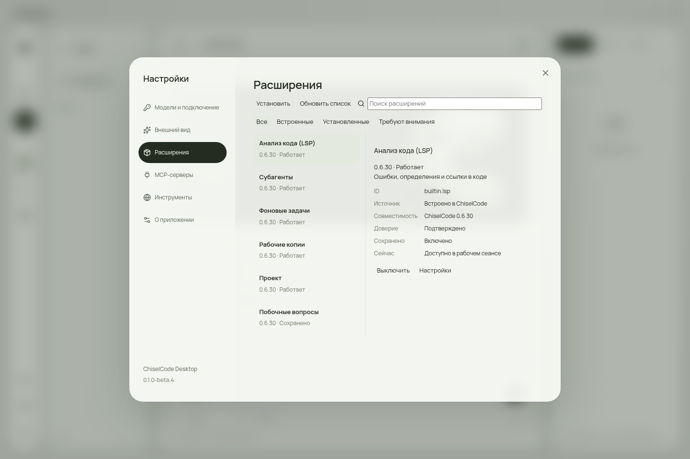
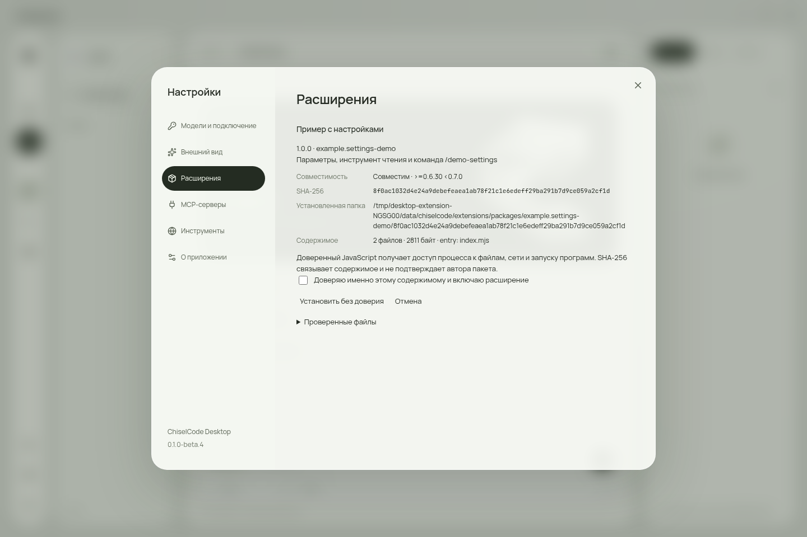
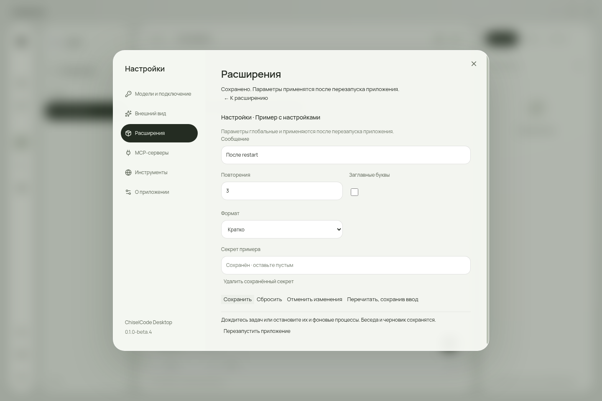
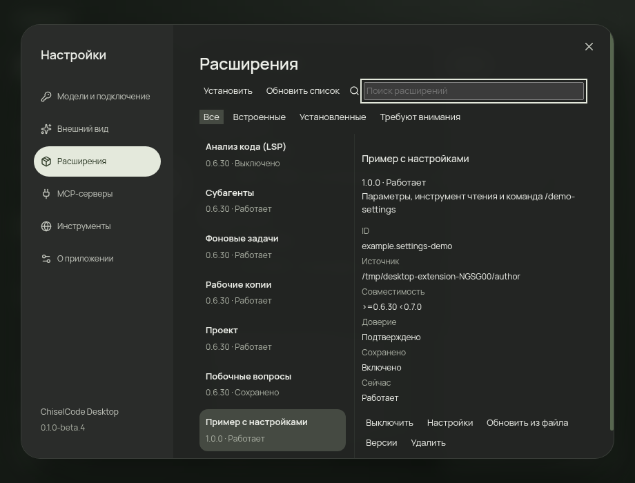

# Проверки управления расширениями

[Документация](README.md) · [Расширения](extensions.md) · [Выпуск](releases.md)

14.10.2026 подготовлена интеграция Desktop 0.1.0-beta.4 с новым core 0.6.30. Исходная база: Desktop `9671bea`, engine lock 0.6.29; core `e232e80` с локальными правками этого задания. Release lock до публикации core не подменялся candidate данными.

Локальный source acceptance использует настоящий compiled engine и SDK тех же core исходников: version 0.6.30, protocol 1.1, SDK 1.1.0. Dev-only `CHISEL_DESKTOP_CANDIDATE_LOCK` указывает отдельную metadata вне Git. Packaged приложения игнорируют этот selector и выполняют штатный handshake с release build-info.

`tests/e2e/extensions.spec.ts` проходит реальный сторонний пакет с tool, command и параметрами через folder/ZIP → review/cancel → untrusted install → exact trust → новый engine process → command/tool → settings → новый process → update/rollback → disable/remove. Проверены global builtin forms, повреждённый и несовместимый ZIP, настоящий stale review после конкурентного изменения registry, отказ validation с сохранением введённых значений, secret DTO, обе темы, compact 920×700, видимый focus, deferred removal, история и неотправленный черновик. OS picker возвращает путь на native test boundary; SDK/core/проверка bytes и права commit настоящие. Во всём сценарии локальный HTTP model fixture получает 0 запросов.

`desktop.spec.ts` отдельно сохраняет настоящий model/tool loop, разрешение записи, отказ, отмену и историю. Локальные `npm run verify` и candidate GUI проходят на Linux; native платформы и установленный release payload проверяются после публикации core/обновления lock. Результаты выпусков добавляются отдельно; предварительный source прогон не объявляет Windows/macOS проверенными.

## Проверка опубликованного ядра

[ChiselCode 0.6.30](https://github.com/TheAsrada/ChiselCode/releases/tag/v0.6.30) опубликован из `9f3858c0d67bf8a0ccc0c22ca6bcec3829a8002a`: [native source CI](https://github.com/TheAsrada/ChiselCode/actions/runs/38579882229), итоговый attempt 3, и [Release](https://github.com/TheAsrada/ChiselCode/actions/runs/38589205716) успешны. Скачаны и проверены все 12 assets, source/version, шесть manifest SHA-256 и GitHub digests. Отдельно прошли package lifecycle smoke из опубликованного npm tarball и извлечённого Linux CLI deb. Промежуточные LSP cleanup hangs и повторы сохранены в core отчёте; итоговая успешная матрица не объявляется их исправлением.

Выполнены штатные `update:engine -- v0.6.30`, `sync:engine`, `npm ci`. Временный candidate vendor заменён опубликованными файлами; настоящий lock содержит protocol 1.1 / SDK 1.1.0 и шесть hashes. Без candidate override прошли `npm run verify` и оба Electron source GUI сценария на Linux. Сохранённые кадры нового раздела обновлены этим прогоном. `npm run package` собрал Linux deb и AppImage; `node scripts/verify-installers.mjs` прошёл оба GUI сценария из каждого извлечённого payload. Native desktop matrix и публикация фиксируются после завершения; этот локальный результат не объявляет Windows/macOS проверенными.

Первый Desktop main CI на `be02bd2` выявил неверное сравнение исходного alias path с canonical DTO на Windows/macOS: engine сохранял правильный проект. Fixture теперь сравнивает точный `projects/open.path`, не повторяя нормализацию в renderer. На macOS Intel первый Electron launch застал незавершённую lazy installation; `test:e2e` теперь сначала запускает штатный installer закреплённого Electron с checksums. Assertions пользовательского сценария сохранены; итоговая native matrix требуется на новом source.

Другие кадры: [активный пакет](assets/screenshots/extensions-working.png), [версии](assets/screenshots/extensions-versions.png), [LSP](assets/screenshots/extensions-builtin-lsp.png), [отложенное удаление](assets/screenshots/extensions-removed-deferred.png). Это screenshots Electron, не сгенерированные макеты. Проверки OpenTUI и общий контракт описаны в [core отчёте](https://github.com/TheAsrada/ChiselCode/blob/main/docs/contributors/reports/extension-settings.md).
