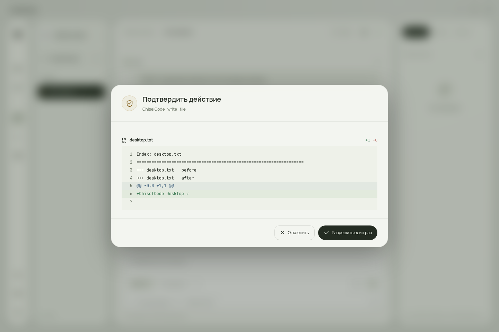

# Проверки первой beta

Тестируется настоящий Electron, ограниченный preload, автономный compiled engine ChiselCode и общий runtime/tools/storage. Для воспроизводимости модель — локальный OpenAI-compatible HTTP fixture; ответы настоящих внешних моделей и оплачиваемые API не участвовали в acceptance.

## Автоматические критерии

| Проверка | Что подтверждает |
|---|---|
| TypeScript + architecture tests | Renderer не импортирует runtime/Electron/Node; версии и протокол разделены |
| Source GUI acceptance | Профиль/endpoint/key, streaming, реальный write_file и diff, разрешение/отказ/отмена, reload истории |
| Установленный payload | Тот же сценарий после NSIS install, deb/AppImage extract, DMG mount/copy и ZIP extract |
| Core process acceptance | Реальный JSON-RPC/SDK, согласование major, credentials redaction, допуск второго процесса, durable resume, сохранённый результат команды и настоящий background process с live output/stop |
| Pinned download + release manifest | Совпадение SHA-256 engine/SDK/skills, происхождение source commit, полный набор установщиков |

Linux source, упакованный GUI и payload deb/AppImage прошли локально. [Финальная релизная матрица](https://github.com/TheAsrada/ChiselCodeDesktop/actions/runs/38508734884) прошла source GUI и установленный payload для Windows x64, Linux x64, macOS arm64 и x64. Она включает интерфейс без слоганов и постоянных подсказок. [Desktop 0.1.0-beta.2](https://github.com/TheAsrada/ChiselCodeDesktop/releases/tag/v0.1.0-beta.2) опубликован из commit `f5ea6eab9c08be163d4bb891612ba4facbe16094`.

Опубликованы **7 установщиков, 17 assets**. Проверены все 12 SHA-256 установщиков/blockmap по manifest и GitHub asset digests, содержимое SHA256SUMS, версии и SHA-512 файлов в трёх updater metadata. Engine lock соответствует ChiselCode 0.6.29. Тег beta.1 был промежуточным и не публиковался; beta.2 содержит исправление неоднозначного поиска заголовка в GUI fixture.

Закреплён [ChiselCode 0.6.29](https://github.com/TheAsrada/ChiselCode/releases/tag/v0.6.29), source commit `b9fc6dfcc6c62743c65a5bb311ccb5e8ca7d679f`. Итоговый локальный полный suite: **1194 pass, 3 skip, 0 fail**, 1197 tests/145 files. [Core release workflow](https://github.com/TheAsrada/ChiselCode/actions/runs/38505192438) прошёл полный suite и compiled protocol acceptance на Windows/Linux/macOS arm64/x64, затем опубликовал SDK, engine binaries, skills и manifest.

Core дополнительно выполняет runtime evaluation и packaging/native CLI проверки в своём CI. Ранние прогоны при разработке выявляли отсутствующие внешние LSP зависимости, timeout OpenTUI под нагрузкой и неверный лимит background output. Окружение подготовлено, лимит исправлен и проверен настоящим процессом; приведённый итог относится к финальному полному прогону. Переход на новый engine требует повторения acceptance.

[Полный core CI](https://github.com/TheAsrada/ChiselCode/actions/runs/38505190471) завершился успешно на Windows/Linux/macOS, включая installed/compiled CLI и native проверки. Windows job повторён после одного превышения прежнего 5-секундного таймаута LSP-status; при повторе прошли весь suite и последующие packaging checks.

## Настоящие кадры

Кадры получены GUI acceptance, с локальным тестовым профилем и тестовым проектом. Они показывают работающее приложение, а не дизайн-макет.

## Практические ограничения

Нет проверки publisher certificate Windows/Apple notarization, live API каждого провайдера и перехода updater на ещё не выпущенную следующую версию. Generic tools используют существующие core тесты; отдельный GUI-сценарий каждой tool/MCP/LSP/worktree комбинации не заявляется. Полный перечень реализованных графических сценариев — в [таблице возможностей](features.md).

Старый CLI до 0.6.28 не соблюдает новый cross-process lease. Первый desktop beta не обещает совместную запись такой версией и не меняет format migration самостоятельно.
